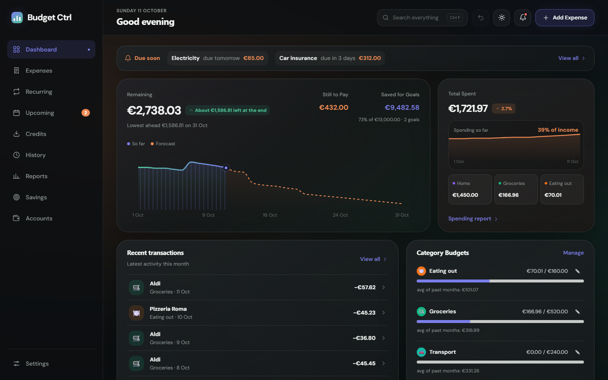
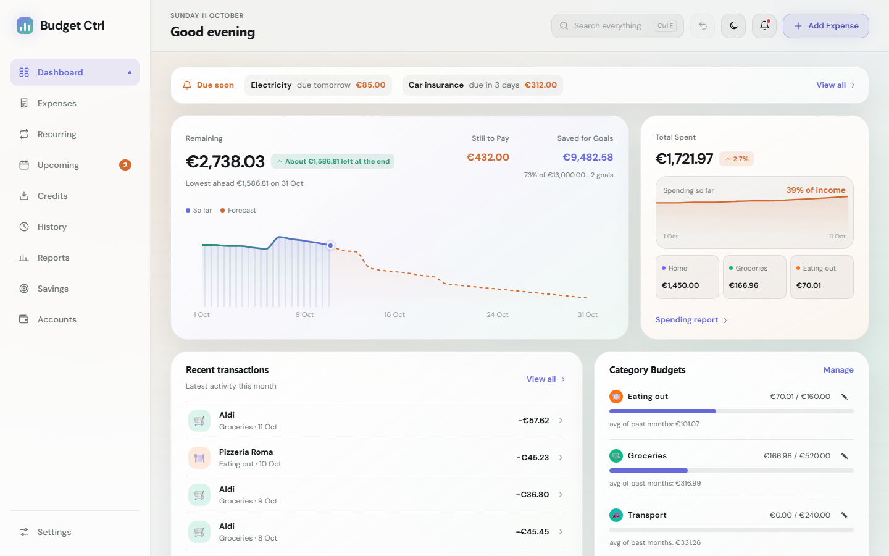
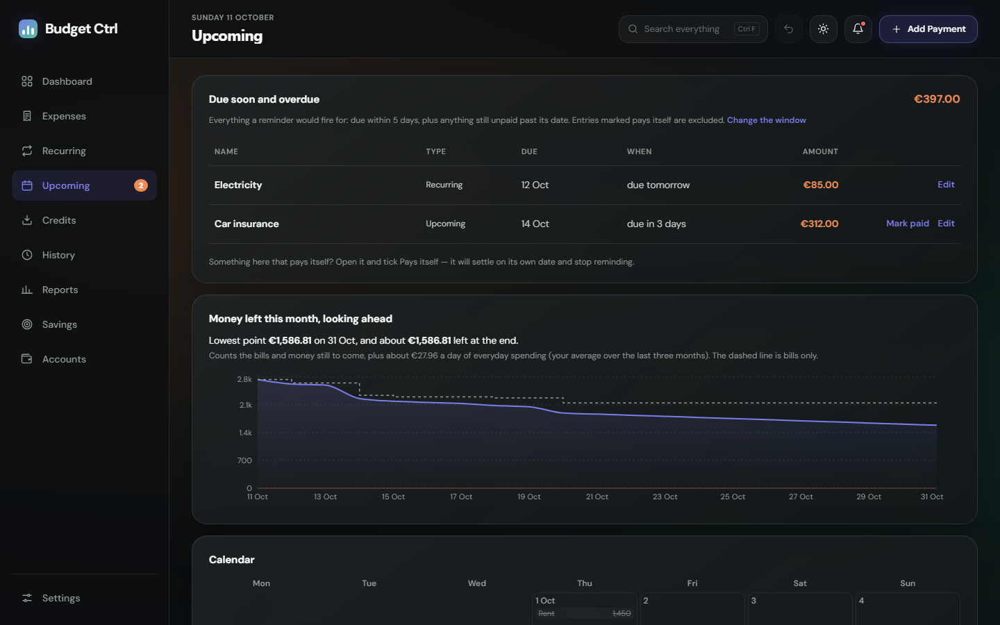
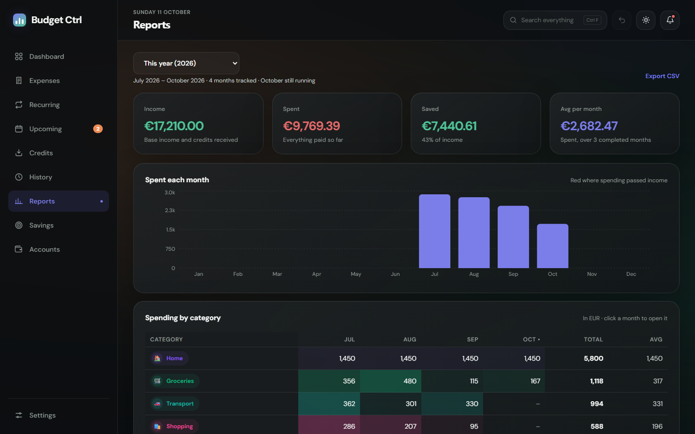
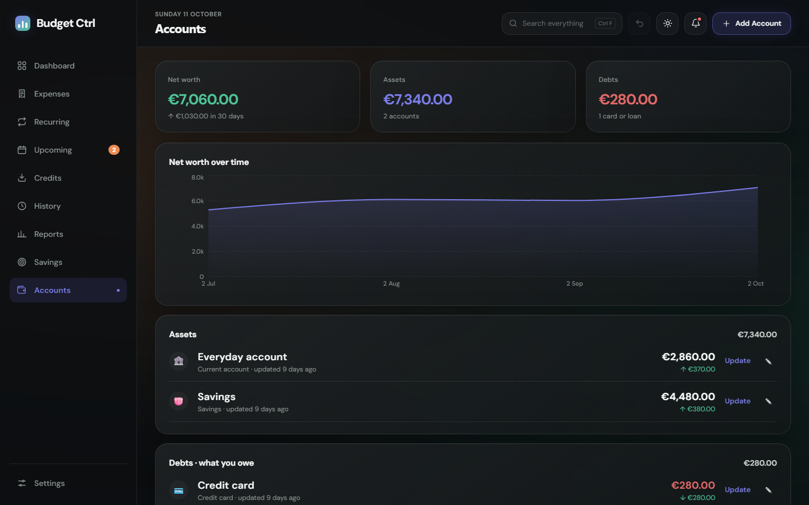

# Budget Ctrl

A personal budgeting app for Windows and Linux. It lives in the system tray,
follows your actual payday rather than the calendar month, and tells you about
bills before they land.

Built with React and Tauri. Everything stays on your machine — there is no
account, no server, and nothing leaves the device.



<table>
  <tr>
    <td width="50%"><br><sub><b>Light theme</b> — the same design, one click away</sub></td>
    <td width="50%"><br><sub><b>Upcoming</b> — what's due, and where the month is heading</sub></td>
  </tr>
  <tr>
    <td width="50%"><br><sub><b>Reports</b> — each category month by month</sub></td>
    <td width="50%"><br><sub><b>Accounts</b> — balances and net worth</sub></td>
  </tr>
</table>

<sub>Screenshots use a made-up budget.</sub>

---

## What it does

A dark, glassy desktop budgeting app (with a light version), built around
the month: what's left, what's coming, and where it went.

**Budget periods that match your payday.** If you're paid on the 10th, a budget
period runs the 10th to the 9th. Recurring bills resolve to the date they
actually land inside that period, including short months.

**Bills that chase you, not the other way round.** The app keeps running in the
tray after you close the window and sends a daily digest of anything due within
your lead window, plus anything still unpaid past its date. Bills that pay
themselves — direct debits, card-on-file subscriptions — can be marked as such
and will settle on their own date without ever reminding you.

**Your currency and number format.** Both are settings — pick the currency you
actually hold and how you want figures punctuated.

**In your language.** English, German, Spanish, Polish or Simplified Chinese —
the whole app, its reminders and its dates, following your Windows language or
chosen in Settings.

**Money in, not just money out.** Credits cover refunds, gifts, bonuses and
salary, as one-offs or recurring, and are kept separate from spending so they
never distort the category breakdown.

**A live Remaining figure.** A recurring bill only counts against Remaining once
its day has passed, and a one-off only once it's settled. What you see is money
you still have, not money you will eventually have spent.

**Category budgets that can roll over.** Give any category a monthly budget. Turn
on rollover for the ones that work like an envelope — gifts, clothes, car
repairs — and what's left carries into next month, while overspending carries
as a deficit. Changing a budget never rewrites what earlier months carried.

**Accounts and net worth.** List your current account, savings, cash,
investments, cards and loans, and type in each balance when you check it — one
field and Enter. You get net worth, assets against debts, a net worth chart and
the change over the last 30 days, with a nudge when a balance is over a month
old.

**Savings goals.** As many as you like: a holiday, an emergency fund, a car.
Each has a target and, if you want, a month to reach it by. A goal counts either
the balance of one of your accounts or what your budget leaves over each month,
and tells you what it needs per month to land on its date, or when you'll get
there at your current pace. The Dashboard adds up what your dated goals need
and offers to set that aside.

**Statement import that learns.** Import your bank's CSV and nothing is counted
twice. Tick **Always** on a row and that payee is named and filed for you on
every import after. Payments that turn out to be monthly bills are spotted and
offered as recurring bills.

**See the month ahead.** A calendar of every bill and expected credit, and a
forecast of the money left this month - its lowest point, what's left at the
end, and a warning if you'd run short before payday.

**Split payments.** One receipt can be split across categories, and each part
counts where it belongs.

**A PIN lock.** Optional: locks at start, when idle and when hidden, and keeps
the budget out of sight until you enter it.

**Search everything.** Ctrl+F finds any entry in any month by name, category,
note or amount, with filters for type, category, dates and amount, and the total
spent and received across what it finds.

**History you can correct.** Every past period is editable — income inline from
the Savings table, everything else in place. Periods corrected after the fact
are marked, so a hand-adjusted figure never passes for a calculated one.

### The tabs

| Tab | What it's for |
|---|---|
| **Dashboard** | This month at a glance: money left with the forecast to payday, spending so far against the same day last month, recent transactions, category budgets, bills due soon and this month's income plan |
| **Expenses** | One-off spending |
| **Recurring** | Bills that repeat each period |
| **Upcoming** | What's due soon or overdue (exactly what a reminder fires for), then scheduled one-off payments |
| **Credits** | Money in — refunds, gifts, bonuses, salary |
| **History** | Any past period, fully editable |
| **Reports** | Any year, the last 3/6/12 months or all time: each category month by month, what changed, top payees, biggest payments, CSV export |
| **Savings** | Your goals, and what each finished month left over |
| **Accounts** | Balances of your accounts, cards and loans, net worth and how it moves |

---

## Install

### Windows

Download `Budget Ctrl_x.y.z_x64-setup.exe` from [Releases](../../releases) and
run it. It installs for your Windows account only, so it needs no admin rights.

### Linux

Linux builds are on [Releases](../../releases) from 0.5.1. Pick one:

- **AppImage** — runs on most distributions and updates itself. Make it
  executable and open it:
  `chmod +x Budget.Ctrl_*_amd64.AppImage && ./Budget.Ctrl_*_amd64.AppImage`
- **.deb** — for Ubuntu, Debian and Linux Mint:
  `sudo apt install ./Budget.Ctrl_*_amd64.deb`. Updates ask for your password,
  since they install for the whole system.

Reminders arrive as ordinary desktop notifications. The tray icon needs a
desktop that shows tray icons — Ubuntu, KDE Plasma and Cinnamon do; on plain
GNOME, install the *AppIndicator and KStatusNotifierItem Support* extension.
Without one, a closed window comes back when you open Budget Ctrl again from
the app menu.

### Updates

From 0.5.0 on, the app **updates itself**. It checks GitHub once a day, shows a
banner when a new version is out, and installs it only when you click **Install
and restart**. Every update is signed, and anything not signed with the
project's key is refused. Turn the daily check off, or check by hand, in
**Settings → Updates** (Settings is at the bottom of the sidebar).

A new budget opens with three short welcome screens — language, currency, when
your month starts, your income and some starter categories. Afterwards, look in
**Settings** for your reminder lead time and, if you want reminders to survive a
reboot, **Start with Windows**.

### Coming from 0.4.x

Your budget comes with you: 0.5.0 finds it on first launch and converts it,
keeping every month, entry, bill, category and setting. 0.4.x can't update
itself, so this one upgrade is by hand:

1. *Optional, for peace of mind:* in 0.4.x, click **EXPORT** in the sidebar to
   save a backup file.
2. Uninstall 0.4.x from **Windows Settings → Apps**. This removes the program,
   not your budget.
3. Download and run the 0.5.0 installer. Your budget is there when it opens.

If anything looks wrong, choose **Restore a backup file** on the welcome screen
(or **Settings → Data**) and pick the file from step 1.

Uninstall 0.4.x first rather than installing over it: 0.4.x was installed for
all users and 0.5.0 installs just for you, so they would sit side by side as
two copies, and anything entered in the old one wouldn't appear in the new.

> Closing the window does **not** quit the app — it hides to the tray so
> reminders keep working. Quit from the tray icon's right-click menu.

---

## Running from source

Requires [Node.js](https://nodejs.org) 20.19+ or 22.12+ (Vite 8's floor) and the
[Rust toolchain](https://www.rust-lang.org/tools/install) with the
[Tauri prerequisites](https://v2.tauri.app/start/prerequisites/): on Windows the
Microsoft C++ Build Tools and WebView2; on Linux WebKitGTK and friends
(`libwebkit2gtk-4.1-dev libayatana-appindicator3-dev librsvg2-dev libxdo-dev libssl-dev`
on Ubuntu).

```bash
npm install
npm run tauri:dev
```

| Command | What it does |
|---|---|
| `npm run tauri:dev` | The full desktop app with hot reload |
| `npm run dev` | Browser only at `localhost:5173` — no tray, reminders or window chrome. Add `?demo` to the address for a made-up budget instead of yours (and `&tab=reports`, `&theme=light`, `&lang=pl` to choose what it shows) |
| `npm run tauri:build` | Produces a signed installer in `src-tauri/target/release/bundle/nsis/` (needs the signing key, see below) |
| `npm run build` | Builds the web assets only |
| `npm run lint` | ESLint |
| `npm test` | Unit tests (Vitest) for the logic in `src/lib/` |

Notifications need the installed app. Windows attributes a toast through a Start
Menu shortcut that only the installer creates, so they may not appear under
`tauri:dev`.

---

## How it's built

```
src/App.jsx          the app shell and the tab views
src/components/      dialogs and views (Settings, Reports, Accounts, ...)
src/lib/             the budget arithmetic, with tests beside each file
src/locales/        the translations, one file per language
src-tauri/src/lib.rs tray, close-to-tray, autostart, reminders, window lifecycle
```

React 19 + Vite on the front, Tauri v2 on the back. Charts are Recharts. There
is no component library and no CSS framework — styling is a token system in
`src/theme.js` (colours for the dark and light themes, type, radii, spacing),
rendered through inline styles. The look follows a Figma design: dark glass
cards, DM Sans (bundled, never fetched), violet for the accent, green for money
in and orange for money out.

**The due-date checker runs in JavaScript, not Rust.** The period arithmetic —
cutoff days, resolving a day-of-month to a real date, deciding what counts as
due — is non-trivial, and a Rust checker would have reimplemented it in a
second language, where it would drift from the copy the screen uses. Hiding a
Tauri window doesn't kill its webview, so close-to-tray *is* the background
daemon, running the same code the screen does.

Rust's job is the shell: the tray icon and menu, converting a window close into
a hide, registering autostart, and handling the `--hidden` flag that lets a
login launch come up silently.

### Data

Everything is one JSON document - a file in the app's data folder on the
desktop, `localStorage` when run in a browser - keyed by budget period:

```
months: { "2026-09": { income, expenses[], recurring[], upcoming[], credits[] } }
recurringTemplate[], creditTemplate[], categories[], creditCategories[]
goals[], accounts[], importRules[], savingsGoal
cutoffDay, currency, locale, language, reminders, updates
```

A period is keyed by the calendar month it *starts* in, so changing your cutoff
day doesn't invalidate existing keys. Schema changes go through a single
`hydrate()` pipeline that every entry point — load, import, reset — runs, so a
new migration is added in exactly one place.

Backups, restoring, spreadsheet export and starting again are in **Settings →
Data**. Restoring or starting again backs up what you have first, and Ctrl+Z
undoes either.

---

## Known limitations

- **Windows and Linux.** There's no macOS build: one that opens without
  warnings needs a paid Apple developer account to sign it.
- **Clicking a reminder opens the app on Windows only.** On Linux a reminder is
  an ordinary desktop notification.
- **One currency at a time** — set it in Settings, along with number
  formatting. Amounts are not converted between currencies.
- **Notifications need the installed build**, as above.
- Changing the cutoff day re-buckets entries by date and discards the markers
  on periods you'd previously corrected. It asks first, and the figures
  themselves are untouched.

---

## Security

To report a security problem privately, see [SECURITY.md](SECURITY.md). It
also explains what the app does with your data and how to verify a download.

---

## Licence

MIT — see [LICENSE](LICENSE). Use it, change it, ship it; attribution is the
only ask.

---

## Releases

See the [changelog](CHANGELOG.md) for what's in each version, and
[the long-form 0.4.0 notes](docs/releases/0.4.0.md).

The screenshots above are taken from the made-up budget: with `npm run dev`
running, headless Edge or Chrome can save one, for example
`msedge --headless --force-prefers-reduced-motion --window-size=1440,900 --screenshot=docs/screenshots/reports.png "http://localhost:5173/?demo&tab=reports"`.

### Publishing a release

Releases are built by GitHub Actions ([release.yml](.github/workflows/release.yml)):
the Windows installer, the Linux AppImage and .deb, and `latest.json`.

To check a change builds on both systems before releasing, run **Test build**
([build.yml](.github/workflows/build.yml)) from the Actions tab. It builds
unsigned installers and keeps them with the run, without releasing anything.

1. In `CHANGELOG.md`, rename `## Unreleased` to the new version, e.g. `## 0.5.1`.
   That section becomes the release notes, and the "What's new" text in the app.
2. Set the same version in `src-tauri/tauri.conf.json`.
3. Commit, then tag and push the tag:
   `git tag 0.5.1` and `git push origin 0.5.1`
4. Actions runs the tests, then builds the signed installer and `latest.json`
   and opens a **draft** release. Check it and press **Publish**. Installed copies
   offer the update within a day.

A build fails if the tag doesn't match the version in `tauri.conf.json`, or if the
changelog has no section for it.

### The signing key

Every update is signed. The public half is in `tauri.conf.json`. The private half
and its password are held by the maintainer, and only reach GitHub as the
repository secrets `TAURI_SIGNING_PRIVATE_KEY` and
`TAURI_SIGNING_PRIVATE_KEY_PASSWORD`. **If the private key is lost, installed
copies can never be updated again**, so keep a backup of it.

To build an installer locally, point the same two environment variables at the
key file and its password before `npm run tauri:build`.
